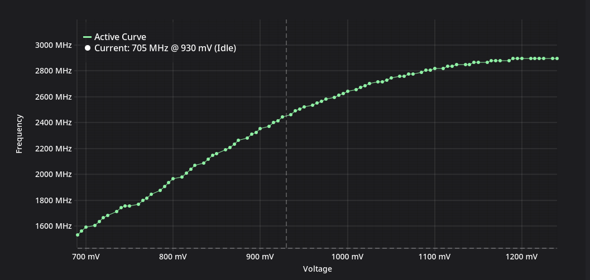

# Basics

## Terminology 
**Undervolting** is limiting the core voltage of the GPU to restrict power draw
**Overclocking** is enabling the GPU to achieve higher clocks

## How modern GPUs work

While under load, the GPU will try to reach the maximum performance possible until it hits one of the limits:
- voltage (v0, vRel)
- power
- thermal

In other words, while under enough load, your GPU will always be throttled/bottlenecked by one of these limits. All of the available knobs we have will target one of those limits

### Voltage
A general rule is that higher voltage allows semiconductors to work at higher frequencies.
Using high voltage all the time will increase power draw, which is why all modern GPUs use a Voltage/Frequency (V/F) Curve to determine clocks+voltage values.

The lower the clock we target, the less voltage we need to be stable

Based on the load and limits, the GPU will pick a point on this curve.

#### How to affect it
Voltage limits set minimum and maximum voltage values. They are defined in the vBIOS and LACT cannot change them.

Instead we can use:
1. Core offset and voltage offset. Practically, they are the same. A positive core offset is the same as a negative voltage offset. We're telling the GPU to use higher or lower clocks at a given voltage point. Editing the V/F curve allows you to change the core offset, so moving points up and down changes the core offset for those points.
2. Clock limits. You can prevent the GPU from going too low or too high on the V/F Curve if you add a lower or upper limit. A common practice is to flatten the V/F curve at a certain voltage point. This removes a reason for gpu to go past this point.
3. **Nvidia-only:** Voltage boost allows you to slightly increase the maximum voltage limit

### Power
Power consumption might be tricky because it depends on the kind of workload. Raster compute units, RT cores, and Tensor cores all have different consumption. Stress-test tools like Furmark can easily push most cards to the limit. You can hit the power limit in one game but be fine in another, while having 99% utilization in both.

#### How to affect it
1. increase the power limit
2. a positive core offset or negative voltage offset will push for higher clocks at a given voltage point, therefore reducing consumption at the same frequency

### Thermal
Cards have soft limits defined by the vbios. When the card reaches the limit, it will reduce clocks.
**Nvidia** cards have a GPU Boost mechanism, which will automatically increase/decrease clocks based on the current temperature. So even before you reach thermal throttling, the driver can decrease the clocks a bit

#### How to affect it
1. more aggressive cooling will bring some performance
2. semiconductor efficiency is near 0, meaning all power they consume is turned into heat. Decreasing the power draw/limit will improve thermals
